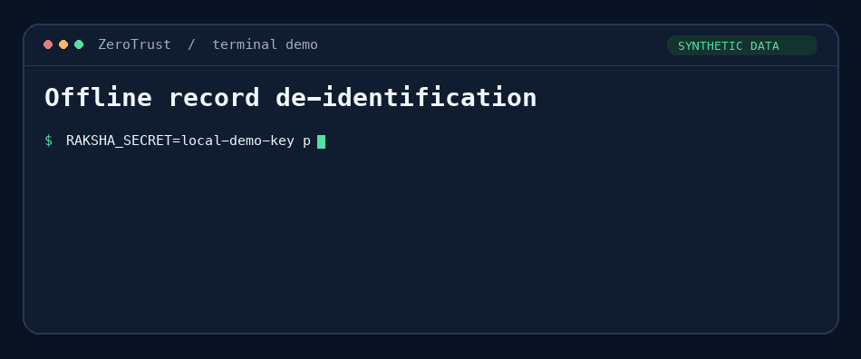

# ZeroTrust

ZeroTrust is an offline command-line tool for de-identifying synthetic
healthcare records. It removes recognised identifiers, links records when
there is enough evidence of a shared patient, and preserves clinical values
for research. It runs on Python 3.11 or later on Linux and macOS, with no
runtime dependencies beyond the standard library.



## Quick start

Run the bundled synthetic example from the repository root:

```sh
RAKSHA_SECRET=local-demo-key python3 main.py \
  --input tests/fixtures/input \
  --output my_output

python3 -m json.tool my_output/report.json
```

Use an empty or new output directory for each run. The example key is for the
bundled demo. For your own synthetic inputs, supply a secret through the
`RAKSHA_SECRET` environment variable and keep it out of source control.
To create a key for your current shell session, run:

```sh
export RAKSHA_SECRET="$(python3 -c 'import secrets; print(secrets.token_hex(32))')"
```

Reuse the key when you need consistent output across runs with the same inputs.

## Supported inputs and outputs

| Input | What ZeroTrust processes |
| --- | --- |
| CSV and TSV | Tabular records with a header row |
| JSON | Structured records, including supported nested layouts |
| FHIR R4 JSON | Supported healthcare resources and single-patient bundles |
| Plain text | Notes with identifier patterns in English, Hindi and Hinglish |

ZeroTrust leaves input files unchanged. It writes three outputs:

| Output | Contents |
| --- | --- |
| `sanitized/` | Cleaned files in supported source formats |
| `report.json` | File hashes, processing outcomes, quarantine reasons, timing and peak memory |
| `records.jsonl` | Exported record locations and patient pseudonyms. Unresolved identities use `patient: null`. |

Malformed or unsupported inputs can be quarantined and are excluded from
`sanitized/`. A nonempty run that exports no files returns a nonzero exit code.

## How it works

1. Parse the inputs and detect sensitive fields or text spans. Use corroborating
   evidence to link patient records across files and formats.
2. Apply [the privacy policy](config/policy.yaml) to sensitive fields, generate
   keyed patient pseudonyms, validate exports, and write the reports.

Date handling preserves encounter intervals where dates are shifted together.
Age and location rules reduce identifying detail. The built-in FHIR checks cover
supported structures and references. Full profile validation requires a separate
validator.

ZeroTrust is designed for synthetic data. Its outputs can still carry
re-identification risk. See the [privacy design notes](docs/privacy-design.md)
for the controls and their limits.

## Verification

```sh
python3 -m unittest discover -s tests -v
```

The suite covers format adapters, multilingual identifier detection, patient
linkage, repeatable exports, clinical preservation, and quarantine behaviour.
The animation shows the results of the four-file quick start above.
